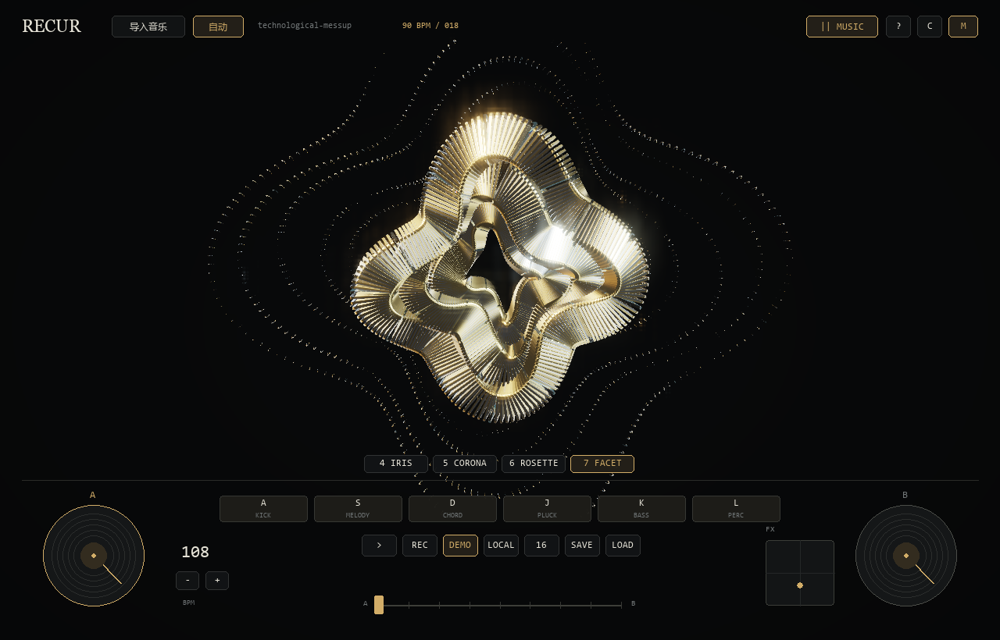
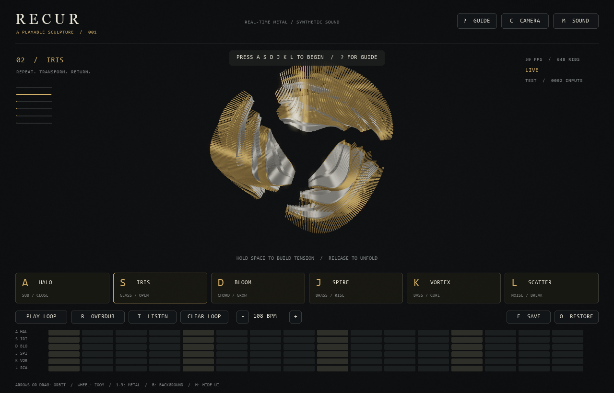

# RECUR / 环生

A Python audiovisual instrument by **CHEN Hongfan**, developed with AI assistance.
Metallic, repeated ribs form a sculpture that can close, unfold, curl, grow and
disassemble in real time. The same action plays an original synthesized sound
and changes the actual geometry. This is not a video player or an AI API wrapper.

The original six forms are preserved: serpent, open ribbon, curling bloom,
crystal field, orbital bands and folded tide. Four additional forms — iris,
corona, rosette and facet — are selected separately with 4/5/6/7. Crossfading,
scratching and the XY effect pad remain available. High-note phrases and
Space releases expand the same sculpture across the screen. Rounded metal,
restrained bloom and about 8% refractive glass accents provide material contrast.
See [visual refinement notes](docs/visual-development.md).

**Author:** CHEN Hongfan · **Course:** SD5913 · **Assignment:** 3, An interactive experience.

**Submission format:** source repository for a local Python artwork. No website
hosting, account, API key or microphone is required to try the main interaction.
The browser experiment is retained in `web/` as optional development work.

The intended user is someone who wants to explore music through a playable
sculpture. They can play notes, build a short loop, hold and release tension, or
import a track and take over its visual response. The feedback is immediate:
geometry opens, folds or changes construction while the corresponding sound or
musical attack is heard.



[20-second program-rendered preview with demo music](docs/demo.mp4). This preview
shows the renderer; it is not a recording of the human trial. If OpenGL is not
available, the image and clip illustrate the result, but do not replace running
the interaction for implementation assessment.

## Run the submitted Python artwork

Open this entire folder in VS Code. Open **Terminal → New Terminal**, then run:

```powershell
uv sync --frozen
uv run python app.py
```

Python 3.11–3.13, a desktop display, and **OpenGL 3.3** are required. `uv` installs
the Python dependencies. No Node.js, paid API, downloaded model, p5.js or camera
is needed. Start with a moderate system volume. The window starts silently
until a note or the demonstration is triggered.

## Play

| Input | Sound and shape |
|---|---|
| A | Soft kick / original elongated serpent |
| S | Glass melody; successive presses vary the pitch / original open ribbon |
| D | Pad following the current chord / original curling bloom |
| J | Warm answering melody / original rectangular crystal field |
| K | Root, fifth and octave bass / original orbital bands |
| L | Soft shaker / original folded tide |
| 4 / 5 / 6 / 7 | Additional iris / corona / rosette / facet; no original form is replaced |
| Hold Space, release | Brake and build tension, then release a bass drop and spatial expansion |
| Tab / drag discs / fader | Select deck, scratch its phrase, blend A/B sound and shape |
| R / OVERDUB | Record live notes into a repeating 16-step pattern |
| PLAY LOOP | Play or stop the pattern |
| Click a grid cell | Add or remove a note; 16 cells = one bar of sixteenth notes |
| T / DEMO | Play/pause the bundled CC0 electronic recording with measured beat following |
| G / LOCAL | Play/stop the original 32-bar synth composition (about 71 seconds at 108 BPM) |
| Z / X | Lower or raise the live S/J melody by one octave |
| P / M | Pause all visual timing / mute all sound |
| Arrow keys or drag | Orbit the sculpture |
| Mouse wheel | Zoom |
| 1, 2, 3 / B | Gold, platinum, copper / dark or light background |
| H / F | Hide interface / fullscreen |
| E / SAVE | Save PNG and `captures/latest-session.json` |
| O / RESTORE | Restore the saved pattern, tempo and material |
| Drop an audio file / V | Play local music with measured frequency response / pause or resume |
| IMPORT / U / Y | Open the music chooser / shortcut / toggle automatic forms and manual control |
| Backspace | Reset sculpture, preserving your composition |
| ? / Escape | Guide / close guide or exit |

Try: play A → S → D → K, hold Space for two seconds and release. Then turn on
OVERDUB, play a phrase, turn OVERDUB off, and edit the grid while it repeats.
CLEAR LOOP requires a second click within five seconds to avoid accidental loss.
The screenshot is the current window including UI; press H before E for artwork.

The default **DEMO** is **Technological Messup** by **Centurion_of_war**, a CC0
electronic recording bundled for offline playback. [Source and license](https://opengameart.org/content/technological-messup),
[asset credits](assets/music/CREDITS.md). The original recording retains its
drums, bass and melody; the app does not add a synthetic drum track over it.

DEMO and imported tracks use the same offline analysis: 100 Hz spectral flux,
short-window attack refinement and adaptive thresholds locate the actual
transients. Measured attacks trigger recoil and fin motion against the audio
playback clock. Beat estimation guides phrase flow, while construction morphs
start before selected accents and finish on them. The program does not need a
manually entered BPM for imported music. Clear percussion gives the most reliable
timing; inferred tempo and beat positions can be ambiguous in beatless or complex
recordings. Visual timing is limited by the display frame rate and audio device.

LOCAL layers kick, hats/claps, bass, chord pads and two melodic parts through an
intro, theme, build, peak, breakdown and outro. The harmony moves through Dm9,
Bbmaj9, Fmaj9 and Cadd9. The header shows the section, chord and bar. Stopping
LOCAL restores the previous loops and crossfader; it also resumes an imported
track if it was playing before. Live S/J notes and D/K accompaniment follow the
same harmonic palette. Each instrument has independent polyphony so melodic
notes cannot cut off the drum or bass channels.

LOCAL automatically morphs between constructions every two bars, covering all
ten forms with a majority of the original six. Drum attacks drive visible recoil,
melodic envelopes drive travelling folds and layer twisting, and high frequencies
hinge the fins. Section and phrase envelopes open and close the sculpture rather
than holding it at maximum expansion. Y / Auto toggles form selection; pressing
a shape key takes over manually while articulation continues. Stopping LOCAL
restores the previous forms. Imported music uses measured rises in its frequency
envelopes for the same articulation; its drum pulses are not synthesized from BPM.

Generate a WAV preview of the authored score with
`uv run python tools/render_song.py`; files are written to `captures/recur-song.wav`
and `captures/recur-song-preview.wav`. These are original local synthesis.

## Optional external camera

```powershell
uv sync --extra camera
uv run python app.py
```

Connect a USB camera. Press C, select DEVICE 0, 1, 2 or 3 and click CONNECT.
Stop the camera before switching devices. Allow approximately two seconds for
exposure to settle. The four **mirrored** zones trigger S, D, J and K when motion
crosses a threshold. Use +/- in the camera panel to adjust sensitivity. STOP
releases the device asynchronously; reconnect after it has stopped.

This is **frame-difference motion detection, not hand tracking or gesture
recognition**. Lighting changes may also trigger it. No frames are stored,
uploaded or included in exports. Camera failure does not prevent keyboard play.
The external-camera path has **not yet been tested with the user's hardware**.

## Project structure

- `app.py`: event loop, controls, export and restoration.
- `recur/model.py`: transitions, tension and quantized loop state.
- `recur/renderer.py`: original repeated 3D rib geometry, instanced OpenGL
  transformations, HDR and two-scale bloom.
- `recur/materials.py`: rounded metal fins, beveled tiles, studio reflections and
  sparse screen-space refractive glass.
- `recur/crescendo.py`: phrase-driven expansion and shared full-screen architecture.
- `recur/structures.py`: original six constructions plus four optional radial
  additions. Symmetry is a property of the added radial family, not every form.
- `recur/music.py`: local file playback and FFT-based low/mid/high envelopes.
- `recur/audio.py`: six original NumPy-generated stereo patches and a bass drop.
- `recur/composition.py`: pitched live notes, four harmonies and a 32-bar score.
- `recur/motion.py`: transient envelopes and continuous musical articulation.
- `recur/analysis.py`: measured attacks, tempo estimation and beat-aligned form cues.
- `recur/camera.py`: optional local motion input on a background thread.
- `recur/ui.py`: interface rendered by Pygame and composited over the 3D scene.
- `tests/`: state, loop, export validation and sound-array tests.

```powershell
uv run python -m unittest discover -s tests -v
uv run python app.py --smoke-test
uv run python app.py --rhythm-test --mute
uv run python app.py --music "path/to/track.ogg" --rhythm-test --mute
```

## Credits and limitations

Visual reference: **冷锋过境**, *永生 / OUROBOROS* (2022), particularly the
later segmented radial transformations: https://www.bilibili.com/video/BV1f3411g7wK/.
Interaction reference: **Patatap**, Jono Brandel and Lullatone, https://patatap.com/.
These are acknowledged influences, not copied assets. The sculpture is generated
from original code; live voices and LOCAL are synthesized locally. The default
DEMO recording is separately credited under CC0 above. The reference video, music,
frames and models are **not** included or redistributed.



This prototype does not reproduce offline-rendered cinematic quality. Lighting
uses procedural studio reflections and a GGX highlight. Glass refracts a snapshot
of the opaque scene; it does not trace multiple glass layers or off-screen objects.
Use the visible **导入音乐** button (U), drop a local WAV/MP3/OGG/FLAC file into
the app, or launch with `uv run python app.py --music "path/to/track.mp3"`.
Playback and automatic following start on import. Measured low/mid/high envelopes
drive the structure; spectral balance and musical accents guide form selection
with several beats between major changes. Y or the
Auto/Manual button toggles automatic selection; shape keys take over manually.
There is no automatic pitch recognition,
hand tracking or in-app video export. The loop is one bar; recording is note quantization,
not a recording of the desktop microphone. Exported files are ignored by Git.

AI (OpenAI Codex) assisted with concept translation, implementation and debugging;
see PROCESS.md. The author has reported a real trial of keyboard and slider interaction; the
observations and resulting changes are recorded in PROCESS.md. A post-change
retest has not been confirmed. Automated checks are separate from that trial.

For GitHub, commit source, `uv.lock`, documentation and a deliberately selected
preview image. Do **not** upload `.venv`, reference recordings or `.reference/`.
No remote repository is created or pushed by running this program.

## Error handling and verification

The selected interruption is cancelling the music chooser or choosing an invalid
file. Cancellation resumes the previous track. Failed decoding/analysis leaves
the current track available and displays feedback. Empty or corrupt session data
is rejected without replacing the current loop. Camera and audio-device failures
also leave visual controls available.

Automated development checks: 39 Python unit tests, ten-form OpenGL smoke test,
keyboard/loop/save/restore interaction check, and separate demo/import rhythm
checks. These checks do not establish musical preference or replace the human
trial described in PROCESS.md. On the development computer, both music playback
checks ran around 59 FPS; other hardware may differ.

## Assignment submission

The course requires the URL of a **public GitHub repository under the student's
own account**, submitted to Canvas; live website hosting is optional. See
[formal brief](https://github.com/sd5913/teaching/blob/main/syllabus/03-interactive-experience.md)
and [submission checklist](SUBMISSION.md). Review PROCESS.md before submitting,
and preserve real subsequent commits rather than inventing past history.
