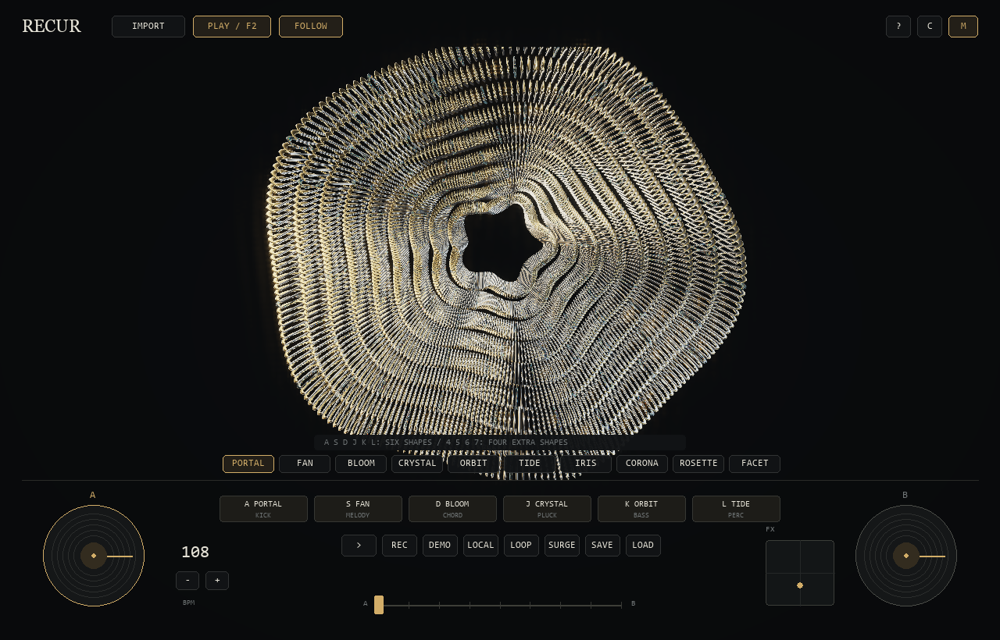
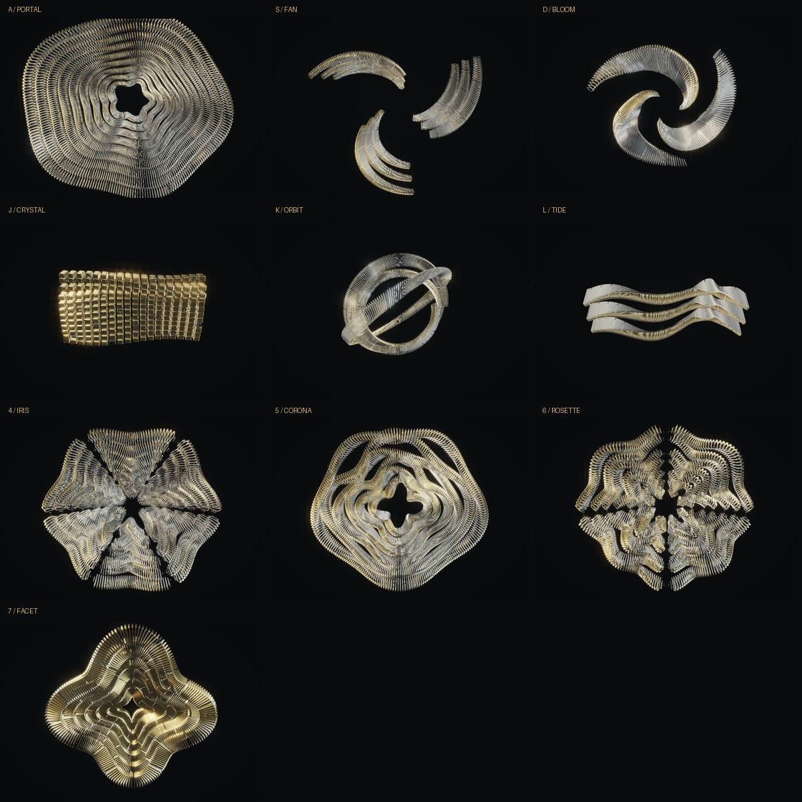
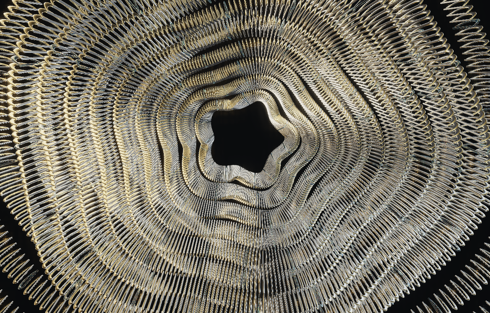

# RECUR / 环生

**Public repository:** https://github.com/CHEN526-f/recur
**Author:** CHEN Hongfan · **Course:** SD5913 · **Assignment:** 3

RECUR is a playable audiovisual instrument. Six keys select six distinct
3D constructions with harmonic/percussive sounds. Four extra keys restore the
radial constructions. You can combine keys or touchscreen contacts, build a loop,
or import music. Shapes reassemble smoothly; note accents keep their own tails.

The intended user is someone exploring rhythm, gesture and visual composition.
The original layered metal construction is the default view again, with actual
3D curved fins, beveled facets, depth testing, studio reflections and sparse
refractive glass. The main silhouette changes with the played key instead of
remaining fixed on an iris. Existing performance features remain available.



[One-minute renderer preview with the bundled recording](docs/demo.mp4).
The clip is generated by the real renderer, not footage of the reported human trial.

## Run

Open this folder in VS Code, then open a fresh terminal:

```powershell
uv sync --frozen
uv run python app.py
```

The application opens its own window. It requires Python 3.11–3.13, an audio output
and OpenGL 3.3. A microphone, login, paid model or API key is not required.
The first dependency setup needs an internet connection. Click the window before
playing keys. The title contains “polyphonic instrument”.

## Perform

| Key | Visual voice | Sound |
|---|---|---|
| A | Portal: nine nested metallic crowns | Kick |
| S | Three layered, unfolding fans | Glass melody |
| D | Bloom | Chord |
| J | Crystal | Warm pluck |
| K | Orbit | Bass |
| L | Tide | Percussion |



Normal keys select their complete constructions directly, without Shift. A new
key reassembles the main silhouette from its current pose in about 0.72 seconds.
The most recently played key determines the destination; notes from earlier keys
continue their own accent envelopes. Repeating a key does not restart an unfinished
transition. A is a nine-layer portal with counter-rotation and depth, replacing
the single ring. S opens three separate layered fans. D/J/K/L retain their construction; radial extras
use six layers. Transient-driven articulation restores visible beat motion.

Try A + S, then add D or J while the first notes finish. Each accepted hit keeps
its own smooth attack and release. Holding a key does not repeatedly retrigger it.
S/J melodies vary their notes within a shared harmonic palette. Separate audio
channels keep a melodic voice from cutting off the bass or drums.

Click the pads or tap the canvas's six zones. Touchscreens that expose SDL finger
events support simultaneous contacts; releasing one finger leaves other contacts
and animation tails intact. An ordinary laptop touchpad may expose only a mouse
cursor. Automated multi-touch checks use synthetic finger events; a physical
multi-touch device has not been verified.

| Input | Action |
|---|---|
| T / DEMO | Play/pause the bundled CC0 recording |
| U / IMPORT / drop an audio file | Import music and analyze it locally |
| V / Y | Pause the imported track / toggle its visual accompaniment |
| G / LOCAL | Start/stop the original 32-bar synthesized score |
| I / LOOP | Open the 16-step editor |
| Click a grid cell | Add/remove a note; adding auditions it and starts playback |
| R / REC | Overdub live notes into the selected deck's loop |
| Tab / crossfader | Choose deck A/B / mix their sound gains |
| Z / X | Lower/raise the live melody octave |
| FX pad | Tone, echo, local torsion and spatial spread |
| P / M | Pause all animation / mute audio |
| H / F | Artwork-only view / fullscreen |
| N / SURGE | Trigger a screen-spanning metallic crown, with a smooth return |
| E / SAVE | Save an image and session in `captures/` |
| O / LOAD | Restore the saved loops, tempo and material controls |
| A/S/D/J/K/L / shape buttons | Choose portal, fan, bloom, crystal, orbit or tide |
| F2 / SCULPT | Switch to the earlier single-sculpture interaction study |
| 4 / 5 / 6 / 7 | Choose iris/corona/rosette/facet as the main construction |
| Backspace / Escape | Reset controls while retaining loops / exit |

The loop editor names its voices and steps, displays a playhead, playback state,
deck gain and mute status. Editing pauses the imported song or exits LOCAL while
restoring the user's loops. A silent edited deck is brought into the mix so its
new note can be heard. CLEAR requires a second click to confirm.

Application labels, guidance, notices and supplied documentation are English.
The project title retains its Chinese name. Native operating-system dialogs and
user-provided file paths follow the operating system's locale.

## Music following

The default demo is **Technological Messup** by **Centurion_of_war**, distributed
under CC0 and bundled for offline playback. [Source](https://opengameart.org/content/technological-messup),
[asset credits](assets/music/CREDITS.md). The original drums, bass and melody are
played directly; the app does not add a synthesized backing track over the recording.

WAV, MP3, OGG and FLAC files up to ten minutes are supported. Offline 100 Hz
spectral flux and short-window onset refinement locate measured attacks. These
attacks schedule the same visual voices used by the keys. Band balance and
strength distribute midrange notes, bass outlines and accents; this is visual
orchestration, not recognized notes, chords, emotion or musical genre.

Measured attacks drive articulation and can select a new complete construction.
Whole-form changes follow musical accents, beat position and changes in band
balance, with at least two beats between changes. Reassembly duration follows
tempo and attack strength. Quiet hats add detail without switching the whole form;
strong on-beat percussion accents can reassemble it after a longer phrase.
There is no timer that advances shapes without a note. Manual selection takes
priority for 2.2 seconds. Percussive accents continue during this interval.
Live keys can add notes while the recording continues. Beat detection is strongest
with clear percussion; device latency and ambiguous rhythm remain limitations.

At a musical climax, nine extra ordered crown layers emerge around the current
construction. The stage opens to the window edges and the view moves forward
slightly. N / SURGE performs this expansion directly; a held Space release can
also produce it. H hides the controls and F enters fullscreen. Expansion changes
geometry and framing while retaining the existing restrained lighting and bloom.
The stage recedes naturally after the phrase. S/D/J/K/L and 4/5/6/7 retain their
different core shapes beneath the crown.



LOCAL is an original 32-bar composition, about 71 seconds at 108 BPM. It combines
kick, hats/claps, bass, chord pads and two melodic parts through an intro, theme,
build, peak, breakdown and outro. Harmony moves through Dm9, Bbmaj9, Fmaj9 and
Cadd9. Stopping LOCAL restores previous loops and resumes the earlier track if
it was playing. Live notes follow the same harmonic palette.

## Main construction and preserved controls

Normal A/S/D/J/K/L keys and shape buttons select six distinct constructions.
4/5/6/7 retain iris, corona, rosette and facet. Shift+key also permits silent shape
selection. Shape selection is saved with the session.
F2 retains the earlier interaction study. Camera orbit, zoom, palettes, background,
Space brake/release, crossfading, overdub, loops and music import remain available.
Dragging the canvas rotates the view without playing a note or selecting a shape.
Automatic shape selection is held during an orbit drag; musical accents continue.
A short canvas click plays on release; pads and keyboard notes still trigger on press.

## Implementation and limits

- `recur/polyphony.py`: independent motion notes, contact ownership and base selection.
- `recur/spatial.py`: the shared original 3D construction and bounded local motion fields.
- `recur/player.py`: keyboard, mouse, finger, loop and music routing.
- `recur/audio.py` / `composition.py`: local stereo synthesis, pitched live notes
  and the original score.
- `recur/analysis.py` / `music.py`: measured transients, local decoding and playback.
- `recur/renderer.py`: OpenGL drawing, two surface passes and restrained HDR bloom.
- `recur/ui.py`: English controls and guide, composited over the stage.
- `recur/vj.py`, `structures.py`, `organism.py`: preserved sculpture experiments.

Stage geometry is three-dimensional and uses the original metal/glass renderer.
Glass refracts the resolved opaque image; it cannot trace multiple layers or
objects outside the framebuffer. Simultaneous voice density is bounded. The
optional camera remains a local input study, not hand or gesture recognition.
The optional `web/` folder is an earlier browser experiment, localized to English;
it is not the primary submission and is not automatically deployed.

Cancelling import resumes the previous recording. Invalid decoding leaves the
previous track available. Corrupt session data is rejected atomically. Audio or
camera failures leave the remaining controls available. These interruptions and
the actual reported keyboard/slider trial are described in PROCESS.md.

## Verification and submission

```powershell
uv run python -m unittest discover -s tests -v
uv run python app.py --polyphony-test --mute
uv run python app.py --interaction-test --mute
uv run python app.py --rhythm-test --mute
```

The current checks include 60 Python unit tests. They cover independent tails,
distinct voices, paused time, input ownership,
held-key suppression, synthetic multi-finger routing, loops and error handling.
They are development evidence and do not replace a human usability trial.
See `SUBMISSION.md` for the repository submission checklist and `CREDITS.md` for
attribution. OpenAI Codex provided substantial implementation assistance; the
project does not claim to be entirely hand-written. No participant result or
historical commit date was fabricated.
